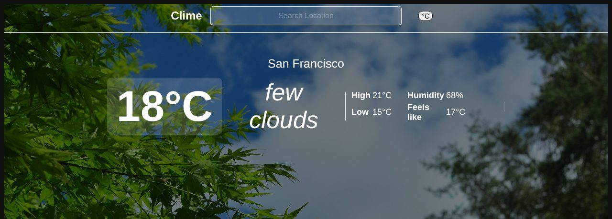

# Clime

A weather app built with React and TypeScript. It shows the current weather for your location, or for any city you search, and changes its background to match the temperature.

**Live demo:** https://weather-website-wheat.vercel.app



## Features

- **Weather where you are:** on first load it asks for your location and fetches the weather for those coordinates. If you decline, you can still search for any city.
- **City search:** type a city and press Enter.
- **Current conditions:** temperature, description, daily high and low, humidity and "feels like", with a °C / °F toggle.
- **Background that follows the temperature:** four photo themes (cold, cool, warm, hot), chosen from the current temperature.
- **Short-lived cache:** the last response is kept in `sessionStorage` for 10 minutes, so reloading the page doesn't call the API again.
- **Error states:** an unknown city or a failed request shows a message instead of a blank screen.

## Tech stack

| Area | Tools |
| --- | --- |
| UI | React 19, TypeScript, Framer Motion |
| Data | [OpenWeather Current Weather API](https://openweathermap.org/current) |
| Build | Create React App |
| Hosting | Vercel |

## How it works

- `App.tsx` holds the state: the weather response, loading and error flags, the unit, and the temperature that picks the background.
- `getWeatherByPosition` calls OpenWeather with coordinates on first load, or with the city name after a search. It checks the response's `cod` field, because OpenWeather returns error details in the JSON body.
- The background theme is computed with `useMemo`, so it only changes when the temperature or loading state changes. `Nav` and `CurrentInfo` are wrapped in `React.memo` to skip re-renders when their props don't change.

## Run it locally

Requirements: Node.js 18+ and a free [OpenWeather API key](https://home.openweathermap.org/api_keys).

```bash
git clone https://github.com/Joonskk/Weather-Website.git
cd Weather-Website
npm install
cp .env.example .env   # then put your API key in .env
npm start
```

Then open http://localhost:3000.

## Notes

Create React App bundles `REACT_APP_*` variables into the browser code, so the OpenWeather key is visible to anyone who opens the site. That's acceptable for a free, rate-limited key. A production app would send requests through a small server or serverless function that holds the key.
